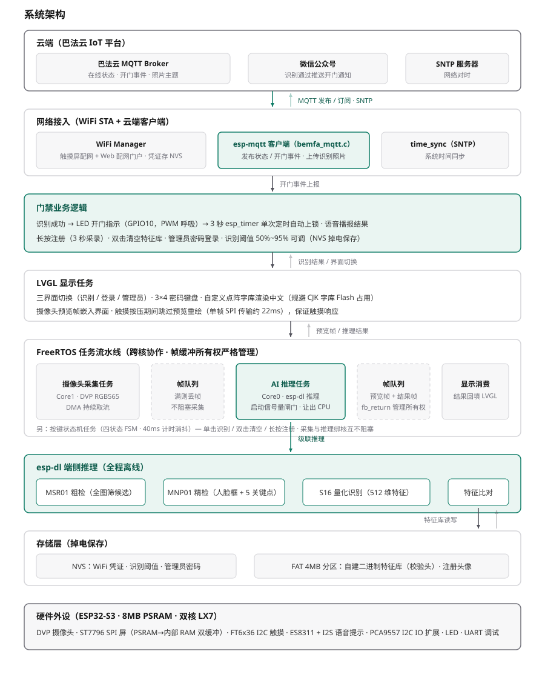
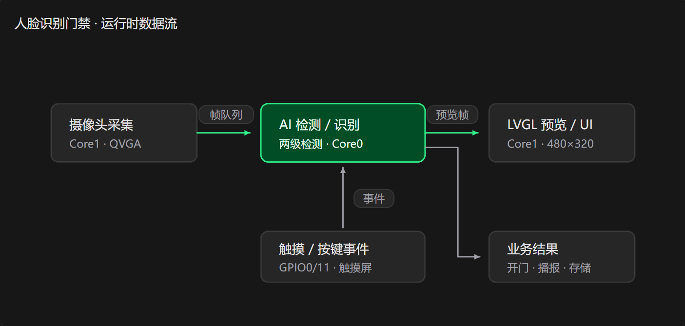

# 基于 ESP32-S3 的离线人脸识别门禁系统

运行在 ESP32-S3 上的**端侧离线**人脸识别门禁：人脸检测与识别全部在本地完成，不依赖云端服务。
基于乐鑫 esp-dl 深度学习框架，两级级联人脸检测 + S16 量化识别模型本地推理，
FreeRTOS 四任务流水线跨核协作，LVGL 触控界面，人脸特征库掉电持久化。

## 系统架构



自上而下分为六层：云端（巴法云）→ 网络接入 → 门禁业务 → LVGL 显示任务 → FreeRTOS 任务流水线 → esp-dl 端侧推理，底部为存储层与硬件外设。

- **主链路（绿色）**：摄像头采集（Core1）→ 帧队列 → AI 推理（Core0）→ 帧队列 → LVGL 显示 → 识别成功开门并经 esp-mqtt 上报云端
- **存储双通道**：NVS 存配置类小数据（WiFi 凭证 / 阈值 / 管理员密码），FAT 分区存自建二进制人脸特征库与注册头像
- **关键总线约束**：PSRAM 与 SPI Flash 共用 MSPI——写特征库前必须暂停采集并排空帧队列；预览帧单次 SPI 传输约 22ms，触摸期间跳过重绘

### 运行时数据流



## 功能特性

- **离线人脸识别**：MSR01 粗检全图筛候选 → MNP01 精检输出人脸框与关键点 → S16 量化识别模型提取 512 维特征，本地比对，识别相似度阈值 50%~95% 可调（NVS 掉电保存）
- **人脸注册与管理**：长按注册（3 秒倒计时采集成悟面部特征）、双击清空特征库；识别通过自动开门，3 秒后定时器自动上锁
- **触控登录界面**：LVGL 三界面切换（识别 / 登录 / 管理员），3x4 数字密码键盘，管理员密码 NVS 掉电保存
- **语音提示**：ES8311 + I2S 播放固定提示音（识别成功 / 失败 / 输入提示），中文 UI 使用点阵字库渲染，规避 CJK 字库的 Flash 占用
- **WiFi 配网**：触摸屏输入热点凭证（NVS 掉电保存），并支持 Web 配网门户（手机连入设备热点后网页提交 SSID/密码）
- **云端联动（巴法云）**：MQTT 上报设备在线状态与开门事件；识别通过后抓拍照片上传图片主题；绑定微信公众号后推送开门通知；SNTP 网络时间同步

## 关键技术点

- **FreeRTOS 四任务流水线**：摄像头采集（Core1）→ 帧队列 → AI 推理（Core0）→ 帧队列 → LVGL 显示，采集与推理绑不同核心互不阻塞；队列满时丢帧不阻塞，保证摄像头 DMA 持续工作
- **PSRAM 与 SPI Flash 总线冲突处理**：PSRAM 与 Flash 共用 MSPI，写 Flash（注册/清空人脸库）前先暂停采集、排空帧队列，解决 `cam_hal EV-EOF-OVF` 丢帧问题
- **SPI 总线调度**：预览帧单次传输约 22ms，触摸按压期间跳过预览重绘，保证 LVGL 触摸响应不被拖慢
- **内存精细管理**：AI 任务启动用信号量做闸门，避免与任务创建争抢内部 RAM；主动让出 CPU 解决 IDLE0 喂狗超时；帧缓冲所有权严格管理，杜绝泄漏与复用错乱
- **自定义特征库持久化**：定位并绕过 esp-dl 在 ESP-IDF 5.x 下非扇区对齐擦除的缺陷，自建二进制文件格式（magic / version / count / dim 校验头 + 记录体）序列化到 4MB FAT 分区，开机自动恢复特征库

## 硬件平台

| 外设 | 型号 / 接口 | 用途 |
| --- | --- | --- |
| 主控 | ESP32-S3（8MB PSRAM） | 双核 Xtensa LX7，AI 推理与业务逻辑 |
| 摄像头 | DVP 接口，RGB565 / QVGA | 人脸图像采集 |
| 显示屏 | ST7796 SPI，480x320 | 预览与 UI |
| 触摸屏 | FT6x36（I2C） | 触控输入 |
| 音频 | ES8311 codec + I2S | 语音提示播报 |
| IO 扩展 | PCA9557（I2C） | 摄像头电源 / LCD 片选控制 |
| 指示灯 | GPIO10 LED | 开门 / 锁定状态指示 |

## 目录结构

| 路径 | 说明 |
| --- | --- |
| `main/main.c` | 程序入口：外设初始化顺序与启动流程 |
| `main/who_human_face_detection/` | 人脸检测 / 识别核心（esp-dl 推理、帧队列、任务划分） |
| `main/lvgl/` | LVGL 界面：识别 / 登录 / 管理员三界面 |
| `main/font/` | 中文点阵字库 |
| `main/speech_recognition/` | ES8311 codec 驱动与 I2S 音频播报 |
| `main/i2c/`、`main/pca9557.c`、`main/tp.c` | I2C 总线、IO 扩展、触摸屏驱动 |
| `main/lcd.c` | ST7796 SPI 屏驱动（含 PSRAM→内部 RAM 双缓冲） |
| `main/wifi/` | WiFi 管理（NVS 凭证）与 Web 配网门户 |
| `main/cloud/` | 巴法云联动：MQTT 状态上报、微信开门通知、识别照片上传、SNTP 对时 |
| `main/uart/` | UART 串口驱动 |
| `components/esp-dl/` | 乐鑫深度学习框架（识别模型随附） |
| `partitions.csv` | 分区表：4MB FAT 数据分区（人脸特征库 / 头像） |

## 编译与烧录

环境要求：**ESP-IDF v5.5.0**（旧版驱动接口与新版不兼容，版本必须一致）。

```
idf.py set-target esp32s3
idf.py build
idf.py flash monitor
```

云端联动功能需先配置巴法云私钥：

```
cp main/cloud/bemfa_config.example.h main/cloud/bemfa_config.h
```

然后编辑 `bemfa_config.h` 填入自己的 UID（该文件已在 `.gitignore` 中，不会被提交）。

## 使用说明

| 操作 | 功能 |
| --- | --- |
| 长按（>1s） | 注册当前检测到的人脸（3 秒采录，掉电保存） |
| 单击 | 识别：通过则开门指示 3 秒后自动上锁，播报结果 |
| 双击 | 清空全部人脸特征库 |
| 登录界面 | 密码验证后进入管理员配置（阈值调整等） |

## 说明

- 界面框架参考乐鑫 [esp-who](https://github.com/espressif/esp-who) 人脸识别示例，在其基础上完成了任务架构重构、Flash 持久化方案替换与门禁业务逻辑开发
- `docs/images/debug_notes.png` 为开发过程中的调试笔记（PSRAM/DMA 冲突与内部 RAM 紧张问题的定位过程）
